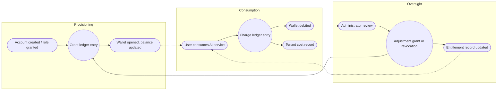
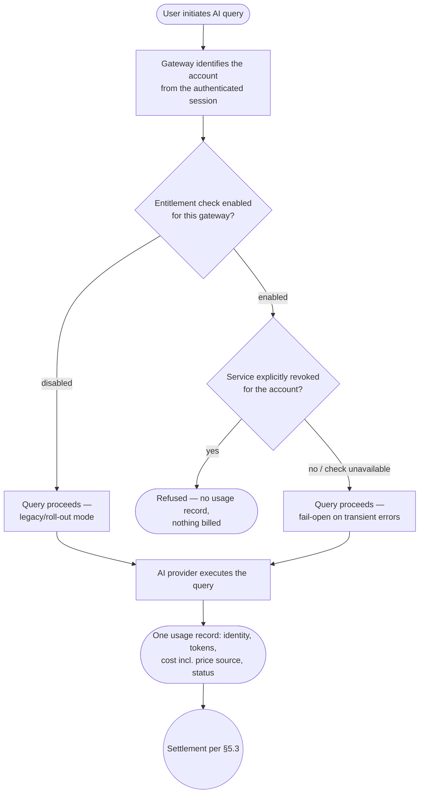
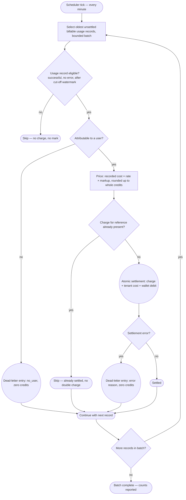
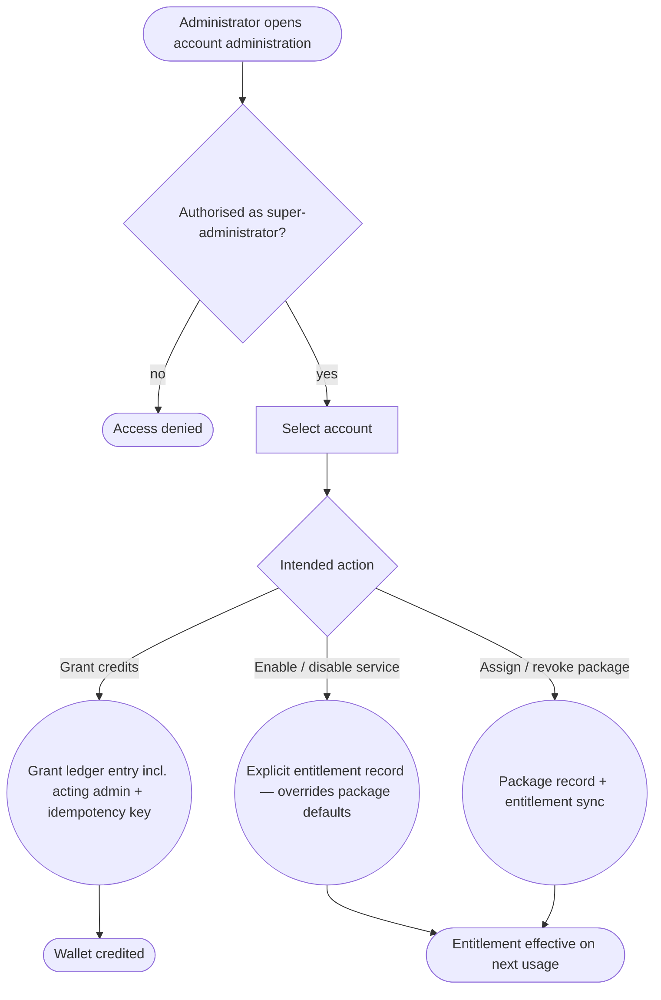
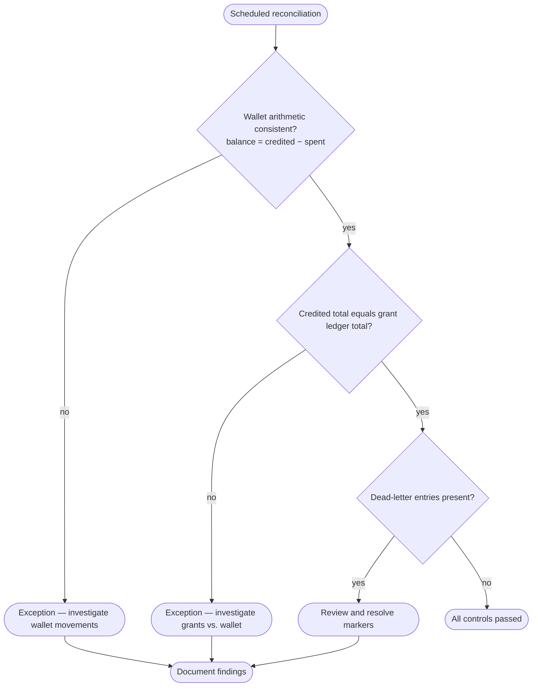

# Audit — AI Credit Wallets

Audit-oriented documentation of the AI credit system (PluraDash). This document
describes the **business logic and control environment** of the credit system as
applied: how credit value originates, how consumption is captured, which records
evidence each business event, and which invariants an auditor can verify at any
point in time.

It deliberately avoids implementation detail; the technical companion is
[`../features/ai-credit-wallets.md`](../features/ai-credit-wallets.md).

- **System name:** AI Credit Wallets (PluraDash)
- **Model:** post-paid prepaid-style ledger — value is granted first, consumed
  later; a negative balance is an accepted, visible operating state
- **Go-live:** migration `033` (PluraDash plugin)
- **Audience:** internal audit, compliance, finance operations, external auditors

---

## 1. Purpose and scope

The AI credit system measures and allocates the cost of AI services consumed by
user accounts:

- LLM queries proxied through the PluraPi AI Gateway,
- voice transcription (Isibot connector),
- text embeddings (knowledge base).

**In scope:** credit granting, entitlement to services, usage capture, wallet
accounting, periodic settlement of gateway usage, administrative intervention,
and the audit trail.

**Out of scope:** payment collection (no payment processor is wired in this
release), tax treatment, and automatic service suspension.

### 1.1 Design principles

| Principle | Statement |
|---|---|
| **Post-paid** | Usage is charged when it occurs. A wallet may go negative; a negative balance is reported, not sanctioned. No automated blocking, suspension or top-up exists. |
| **Credits as sole user-facing unit** | Users see credits only. A currency mapping exists for internal cost allocation and operator reporting and is not exposed on user-facing surfaces. |
| **Append-only evidence** | Value movements are recorded as append-only ledger entries. Corrective entries are new entries, never in-place edits. |
| **Idempotent settlement** | Each usage event is settled at most once, regardless of retries or job restarts. |
| **No silent attribution gaps** | Usage that cannot be attributed to a user is not discarded; it is recorded with an explicit exception marker visible to operators. |

---

## 2. Roles and responsibilities

| Role | Responsibility in the system |
|---|---|
| **End user** | Consumes AI services; sees own credit balance (credits only). |
| **Super-administrator** | Grants credits, enables/disables services per account, manages packages. All administrative actions are authorised, logged and attributable to the acting admin. |
| **Tenant administrator** | Read-only visibility of usage charges of their own tenant's members. |
| **Settlement service (scheduled)** | Settles gateway usage records against wallets in batches; requires no human interaction; every action is evidenced in the charge ledger. |
| **Gateway operator (PluraPi)** | Supplies the usage records (query logs) that settlement is based on, and performs an entitlement check before each query. The check is operator-configured (feature flag, off by default) so the gateway can be deployed independently of the billing system. |

---

## 3. Business rules

### BR-1 — Credit granting

Credits enter circulation **only** through a grant. Every grant is evidenced by
a ledger entry carrying: beneficiary, amount, origin
(`auto-default`, `auto-support`, `manual`, `topup`, `refund`, `adjustment`, …),
an idempotency key, and — for administrative grants — the acting administrator.
A grant can never reduce a balance.

### BR-2 — Entitlement

A service may be consumed only when it is **not explicitly revoked** for the
account. Revocation is always an explicit administrative act. Accounts without
any entitlement record retain historical access (grandfathering) so that a
system roll-out cannot withdraw existing functionality. Entitlement is
independent of balance: an overdrawn wallet does not revoke entitlement.

A refused request is **never billed**: the gateway rejects it before any usage
exists, so no usage record — and therefore no charge — is created for blocked
requests. Refusals leave no financial trace by design.

The service classification used at access time (which service a query belongs
to) is derived from the same categorisation the settlement uses later, so a
request that was allowed is never billed under a different service category.

### BR-3 — Usage capture

Every chargeable usage event carries a stable business reference
(e.g. the gateway query record or the recording identifier). Capture is atomic
with the wallet debit: charge record, tenant-level cost record and wallet
movement either all succeed or all fail together.

### BR-4 — Settlement pricing

Gateway usage is priced from the recorded cost of the query, multiplied by the
configured conversion rate and a non-discounting markup (≥ 1.0). Usage records
that predate the system go-live (a configurable cut-off watermark) are never
billed retroactively.

Each usage record evidences **how its price was determined**
(`openrouter-usage` = exact metering by the upstream provider;
`computed-pricing` = fallback from public per-token pricing; empty = unknown).
Where no price is available, settlement falls back to token counts against the
configured model pricing — a charge is never estimated silently.

### BR-5 — Unattributable usage

Usage without an attributable user is recorded with the marker
`no_user` and zero credits. It is never silently dropped and never misassigned
to another account.

### BR-6 — Error isolation

A single defective usage record never blocks settlement of the remaining
queue. The defective record is marked as an error dead-letter and skipped;
operators can inspect and resolve the backlog.

### BR-7 — Overdraft

Balances may become negative. Negative balances are visible to the account
holder and to administrators. In the current release no automated consequence
follows from a negative balance; any consequence (dunning, suspension) is a
future policy decision and would be a documented change.

---

## 4. Audit trail map

Every business event leaves exactly one class of evidence:

| Business event | Evidence record | Contains |
|---|---|---|
| Credit granted (auto or manual) | Grant ledger entry | Beneficiary, amount, origin, idempotency key, granting admin (if manual), timestamp |
| Service usage charged | Charge ledger entry | User, tenant, service, model, business reference, units, cost, credits charged, timestamp |
| Usage without attributable user | Charge ledger entry with `no_user` marker | Tenant, units, cost — zero credits |
| Settlement error | Charge ledger entry with error marker | Reference of the failed record, error reason |
| Tenant-level cost | Allocation record | Tenant, user (if known), service, model, cost, credits |
| Gateway usage (settlement input) | Query log record (gateway operator's system) | User, tenant, session, model categorisation, token counts, cost **and price source**, status, error, timestamp |
| Refused request (entitlement) | **No financial record** — gateway refusal happens before usage exists | Gateway-side refusal response only |

Records are keyed such that a reviewer can trace **wallet movement → charge →
business reference** (e.g. the original gateway query) and **wallet movement →
grant → authorising actor** in both directions.

---

## 5. Process flows (BPMN-style)

The diagrams below are BPMN-style representations (pools/lanes as subgraphs,
gateways as diamonds) rendered with Mermaid.

### 5.1 End-to-end credit lifecycle

**Audit expectation:** every balance change traces to a ledger entry; every
manual intervention traces to an administrator.

### 5.2 Service usage with entitlement pre-flight (gateway path)

**Audit expectation:** refusals occur only on explicit revocation and leave no
financial trace; a successful execution always yields exactly one usage record
with a traceable reference and an evidenced price source. A temporarily
unavailable control check fails open (documented availability decision) and is
logged.

### 5.3 Settlement of gateway usage (scheduled batch)

**Audit expectation:** settlement is restart-safe; each usage record is charged
at most once; exceptions are visible as dead-letters with a reason.

### 5.4 Administrative intervention

**Audit expectation:** administrative writes are possible only through the
authorised server routes; the acting administrator is identifiable from the
evidence records.

### 5.5 Periodic control procedure

---

## 6. Key controls and testable invariants

| # | Control | Verification (executable at any time) |
|---|---|---|
| C-1 | Wallet arithmetic holds | No wallet row where `balance ≠ lifetime_credited − lifetime_spent` |
| C-2 | Wallet credited total equals grant ledger | Per user: `Σ ledger credits = lifetime_credited` |
| C-3 | No double settlement | No two charge records share the same business reference |
| C-4 | No silent gaps | Every unattributable usage has a `no_user` evidence record |
| C-5 | Retro-billing prevented | No charge exists for usage records older than the cut-off watermark |
| C-6 | Admin attribution | Manual grants carry the acting administrator and an idempotency key |
| C-7 | Least-privilege access | Users read only their own wallet; cross-account visibility is restricted to super-administrators (and tenant admins for their tenant's charges) |
| C-8 | Revocation is explicit | Access is refused only where a disabling record exists; absence of records never refuses access |
| C-9 | Currency isolation | User-facing surfaces carry credits only; currency mapping exists solely in the operator configuration |

The reconciliation SQL for C-1/C-2 and the dead-letter scan is maintained in
[`../features/ai-credit-wallets.md`](../features/ai-credit-wallets.md) §9.

---

## 7. Risk assessment (residual)

| Risk | Assessment | Mitigation in place |
|---|---|---|
| Unbilled usage accumulation (settlement outage) | Low — settlement is scheduled, idempotent and self-healing across ticks | Dead-letter markers expose stuck records; batch continues past failures |
| Misattribution of usage to a wrong account | Low — usage events carry system-generated references; attribution follows the requester's identity, not manual input | Exception markers for unattributable records |
| Unauthorised credit creation | Low — grants are service-role only, reachable solely via authorised admin routes | Authorisation checks, admin attribution, idempotency keys |
| Financial misstatement through retro-billing | Low — cut-off watermark excludes pre-go-live usage | Configurable watermark, verified by control C-5 |
| Overdraft concealed from decision-makers | Low — balances are visible to account holders and administrators | Negative-balance indication on user and admin surfaces |
| **Billing completeness** — gateway logging silently disabled (missing service credential) | Medium — the settlement input would silently stop while chat keeps working | Gateway logs a warning at start-up when its write credential is absent; operators verify settlement counts against gateway activity during roll-out |
| Classification divergence between access control and settlement | Low — both derive the service from the same request categorisation with identical fallbacks | Shared derivation rule, mirrored in the operator handoff |
| Scope creep into automated enforcement | Managed — enforcement (suspension, dunning) is out of scope of the current release | Any future enforcement requires a documented policy change |

---

## 8. Compliance notes

- **Data minimisation:** the credit records contain no personal data beyond the
  account reference and usage metadata required for billing evidence.
- **Transparency:** account holders can view their own balance; hidden charges
  do not exist — every debit corresponds to a visible usage event.
- **Change management:** the system was introduced through a reviewed,
  idempotent migration with a documented roll-back path; subsequent changes to
  business rules (rates, markup, enforcement) require a change record in
  [`../changes/`](../changes/).
- **Third-party boundary:** usage records originate from the PluraPi gateway,
  which contractually guarantees completeness and immutability of the billed
  fields. The schema extension for service categorisation (`0014`) is **owned
  and applied by the gateway operator** (canonical in the PluraPi repository);
  the Specy copy is a mirrored convenience and must not drift. The gateway
  additionally guarantees: one usage record per query (including streamed and
  aborted responses), identity taken from the verified session (never
  client-supplied), and a log-write failure never breaks the user-facing
  service (availability is deliberately preferred over billing completeness —
  see the risk table).

## 9. Open items for future releases

1. Enforcement policy for persistent negative balances (dunning, suspension) —
   requires a business decision and a new documented control.
2. Payment collection integration (grant origins `stripe`/`topup` are reserved
   in the ledger vocabulary but not yet connected).
3. Automated alerting on dead-letter backlog instead of the manual scan.
